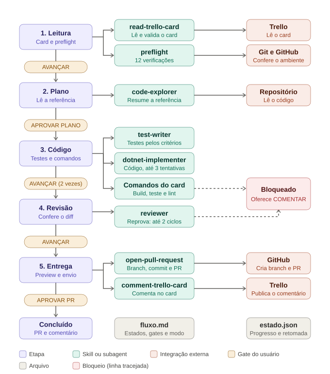

# Agente de Desenvolvimento (v1)

Recebe o link de um card do Trello e implementa a story: valida o ambiente, lê a spec, planeja, escreve testes e código, revisa o diff e abre o PR. Roda no Claude Code. Complementa o agente de refinamento, que gera cards com a label `agent-ready`.

## Fluxo



O fluxo é uma máquina de estados definida em `resources/fluxo.md`. No modo rígido (atual), o gate de usuário de cada passagem é:

| Etapa | O que acontece | Usa | Gate (rígido) |
|---|---|---|---|
| 1 Leitura e validação | Lê o card, confere se é elegível e roda o preflight (ambiente, spec versus código, dependências, linha de base) | `read-trello-card` | AVANÇAR |
| 2 Plano | Lê a referência e propõe o plano | `code-explorer` | APROVAR PLANO |
| 3 Testes e código | Testes pelos critérios, depois código; roda build, teste e lint (3 tentativas) | `test-writer`, `dotnet-implementer` | AVANÇAR (após os testes e após os comandos passarem) |
| 4 Revisão | Confere o diff com a spec (2 ciclos) | `reviewer` | AVANÇAR |
| 5 Entrega | Preview do PR e do comentário no card | `open-pull-request`, `comment-trello-card` | APROVAR PR |

Story elegível: label `agent-ready`, `Tipo: código`, prontidão `pronta` e nenhum item `a definir` ou `(proposto, confirmar)`. O agente nunca deduz o que o card não traz: para e oferece comentar no card (COMENTAR).

## Flexibilidade

| Quero | Faço |
|---|---|
| Tirar uma aprovação manual | Em `resources/fluxo.md`, troque o gate da transição por `auto` |
| Ligar a automação | Troque `modo: rígido` por `modo: automático`, depois de rodar os evals |
| Incluir ou remover um estado | Edite as tabelas Estados e Transições |
| Incluir uma verificação inicial | Acrescente a linha em `resources/preflight.md` |

O `AGENTS.md` não muda. Valem sempre, em qualquer modo, as guardas: preflight, limites de tentativa, escopo de escrita e regras de git. A revisão e o merge do PR continuam humanos.

## Como usar

1. Abra o Claude Code na **raiz do repositório do card**, limpo e na branch base do card.
2. Disponibilize este agente nesse repositório: copie (ou aponte por link simbólico) `.claude/agents/` e `.claude/skills/`, e importe `AGENTS.md` no `CLAUDE.md` do repositório (`@caminho/AGENTS.md`). Mantenha `resources/` ao lado do `AGENTS.md`.
3. Conecte por MCP o Trello e deixe a CLI `gh` autenticada.
4. Diga: `Implementa este card: <link>`.
5. Responda cada gate que o agente pedir.
6. Adicione `estado.json` ao `.gitignore` do repositório (uma vez). O agente o cria e atualiza sozinho, e retoma a sessão por ele.

## Estrutura

```
AGENTS.md          orquestrador: motor genérico e ações dos estados
CLAUDE.md          aponta para AGENTS.md
resources/         fluxo.md (estados, transições, gates, modo), preflight.md,
                   convencoes.md, ajuda.md
evals/casos.md     casos de teste
docs/fluxo.svg     diagrama do fluxo
.claude/agents/    code-explorer, test-writer, dotnet-implementer, reviewer
.claude/skills/    read-trello-card, open-pull-request, comment-trello-card
                   (cada uma: SKILL.md e references/examples.md, references/report.md)
```

Skill é capacidade e funciona sozinha; o processo mora só em `AGENTS.md` e `resources/`. Novas stacks entram como outro implementer (por exemplo `frontend-implementer`), sem mudar o resto.

## Antes de usar em produção

- Restrinja `tools` dos agents às ferramentas necessárias; o `reviewer` e o `code-explorer` são somente leitura.
- Proteja `main` e `develop` no GitHub (branch protection) e exija revisão humana no PR: o agente não faz merge, mas a regra no servidor é a garantia, sobretudo no modo automático.
- Rode `evals/casos.md`, em especial os críticos listados lá.
- Comece por uma story pequena, no modo rígido.
